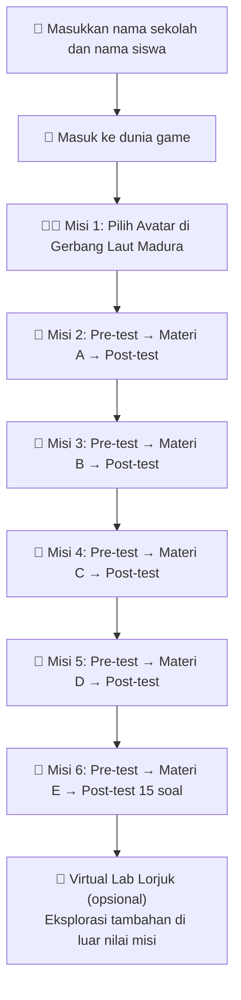

# 🌊 Ecoseaverse — Metaverse Ekosistem Laut Madura & Konservasi Bahari

> **Media Pembelajaran Digital Interaktif Berbasis AI & 3D WebGL**  
> Mengimplementasikan Bab 6 *Ekologi dan Keanekaragaman Hayati Indonesia* (IPA Kelas VII) menjadi alur belajar: nama sekolah dan siswa → dunia bawah laut 3D → Misi 1 memilih avatar di Gerbang Laut Madura → Misi 2–6 mengerjakan pre-test, membaca materi Subbab A–E, lalu mengerjakan post-test per misi, dengan Virtual Lab Lorjuk sebagai eksplorasi tambahan di luar misi.

---

## 📌 Daftar Isi
1. [Tentang Ecoseaverse](#-tentang-ecoseaverse)
2. [Dasar Kurikulum & Referensi Sumber](#-dasar-kurikulum--referensi-sumber)
3. [Struktur Modul Materi Ekologi Lengkap](#-struktur-modul-materi-ekologi-lengkap)
   - [Bab 1: Pengaruh Lingkungan terhadap Makhluk Hidup (Komponen Ekosistem)](#bab-1-pengaruh-lingkungan-terhadap-makhluk-hidup)
   - [Bab 2: Interaksi Antarkomponen Ekosistem (Rantai Makanan & Simbiosis)](#bab-2-interaksi-antarkomponen-ekosistem)
   - [Bab 3: Keanekaragaman Hayati Indonesia & Biota Laut Madura](#bab-3-keanekaragaman-hayati-indonesia)
   - [Bab 4: Pengaruh Manusia terhadap Ekosistem & Konservasi Bahari](#bab-4-pengaruh-manusia-terhadap-ekosistem)
   - [Bab 5: Glosarium Istilah Penting Ekologi](#bab-5-glosarium-istilah-penting-ekologi)
4. [Alur Pembelajaran Terpadu (Materi ➔ Eksplorasi ➔ Misi & Posttest)](#-alur-pembelajaran-terpadu)
5. [Fitur Unggulan Sistem Metaverse](#-fitur-unggulan-sistem-metaverse)
6. [Panduan Menjalankan Aplikasi Secara Lokal](#-panduan-menjalankan-aplikasi-secara-lokal)
7. [Struktur Berkas Proyek](#-struktur-berkas-proyek)

---

## 🌟 Tentang Ecoseaverse

**Ecoseaverse** adalah inovasi media pembelajaran sains (*Science Metaverse*) yang dirancang khusus untuk memfasilitasi pembelajaran bermakna (*meaningful learning*) siswa SMP/MTs. Proyek ini memadukan:
- **Eksplorasi Dunia Virtual 3D Real-Time**: Perairan tropis pesisir Selat Madura dengan pencahayaan dinamis, terumbu karang, padang lamun, hutan mangrove, dan biota laut.
- **AI Marine Guardian**: Agen asisten cerdas pemandu pembelajaran dan literasi lingkungan dengan sintesis suara (*Text-to-Speech*).
- **Laboratorium Digital 3D Kerang Bambu (*Lorjuk*)**: Eksplorasi anatomi, adaptasi penggalian sedimen pasir, mekanisme penyaringan air (*filter feeder*), dan sintesis *Problem-Based Learning* (PBL).
- **Modul Materi Pembelajaran Ekologi Interaktif**: Materi lengkap terstruktur sesuai silabus IPA Kelas 7 untuk membimbing pemahaman sebelum dan sesudah mengerjakan misi evaluasi/posttest.

---

## 📚 Dasar Kurikulum & Referensi Sumber

Modul ini disusun berpedoman pada:
1. **Kurikulum Merdeka — IPA SMP Kelas VII**:
   - **Capaian Pembelajaran (CP)**: Peserta didik mengidentifikasi interaksi antar makhluk hidup dan lingkungannya, serta merancang upaya-upaya mencegah dan mengatasi pencemaran dan perubahan iklim.
   - **Tujuan Pembelajaran (TP)**:
     - Menganalisis pengaruh lingkungan dan komponen biotik/abiotik terhadap organisme.
     - Menyusun dan menganalisis rantai makanan, jaring-jaring makanan, dan piramida ekologi.
     - Mengidentifikasi berbagai bentuk interaksi makhluk hidup (simbiosis, predasi, kompetisi).
     - Menjelaskan keunikan biodiversitas pesisir Indonesia dan Selat Madura.
     - Merumuskan solusi mitigasi pencemaran limbah/mikroplastik dan aksi konservasi bahari.
2. **Dokumen Rujukan Utama Pembelajaran Ekologi**:
   - **Scribd Document**: [*Ekologi dan Keanekaragaman Hayati Kelas 7* / *IPA 7 EKOLOGI*](https://www.scribd.com/document/631023667/IPA-7-EKOLOGI) oleh *adenurosita*.
   - **Kementerian Pendidikan, Kebudayaan, Riset, dan Teknologi**: Buku Panduan Guru dan Siswa IPA Kelas VII SMP/MTs.

---

## 📖 Struktur Modul Materi Lengkap (Bab 6)

> Materi dan soal seluruh misi disusun dalam satu sumber data: `learning-data.js`.

### Subbab A (Misi 2): Pengaruh Lingkungan terhadap Makhluk Hidup — hlm. 162–164

#### 1. Pengertian Ekologi dan Ekosistem
- **Ekologi** berasal dari bahasa Yunani *Oikos* (rumah/tempat tinggal) dan *Logos* (ilmu). Ekologi adalah cabang biologi yang mempelajari hubungan timbal balik antara makhluk hidup dengan lingkungan sekitarnya. Konsep ini pertama kali diperkenalkan oleh biolog Jerman **Ernst Haeckel** (1866).
- **Ekosistem** adalah suatu sistem ekologi yang terbentuk oleh hubungan timbal balik tak terpisahkan antara makhluk hidup (biotik) dengan faktor lingkungannya (abiotik).

#### 2. Satuan-Satuan Makhluk Hidup dalam Ekosistem
1. **Individu**: Satu organisme tunggal.  
   *Contoh di Madura*: Seekor Kerang Bambu (*Solen* sp.), seekor Penyu Hijau (*Chelonia mydas*).
2. **Populasi**: Sekumpulan individu sejenis yang hidup di wilayah dan waktu yang sama serta dapat melakukan perkawinan silang.  
   *Contoh*: Koloni kerang bambu di zona intertidal Pantai Madura.
3. **Komunitas**: Seluruh kumpulan berbagai populasi makhluk hidup yang saling berinteraksi dan hidup bersama dalam suatu wilayah tertentu.  
   *Contoh*: Komunitas terumbu karang yang terdiri atas populasi karang, ikan badut, bulu babi, dan spons laut.
4. **Ekosistem**: Kesatuan interaksi antara komunitas dengan lingkungan abiotik di sekelilingnya.  
   *Contoh*: Ekosistem Pesisir Pantai Berlumpur-Pasir Madura, Ekosistem Terumbu Karang, Ekosistem Hutan Mangrove.
5. **Bioma**: Ekosistem darat berskala luas dengan vegetasi klimaks dan iklim regional tertentu (misalnya Bioma Hutan Hujan Tropis).
6. **Biosfer**: Lapisan bumi beserta atmosfernya tempat seluruh kehidupan makhluk hidup dapat berlangsung.

#### 3. Komponen Penyusun Ekosistem
Ekosistem terbagi menjadi dua komponen utama:

| Komponen | Penjelasan | Contoh di Ekosistem Laut Madura |
| :--- | :--- | :--- |
| **Biotik** *(Makhluk Hidup)* | Seluruh organisme hidup yang mendiami ekosistem, terbagi atas:<br>• **Produsen (Autotrof)**: Menghasilkan makanan sendiri lewat fotosintesis.<br>• **Konsumen (Heterotrof)**: Memperoleh energi dari organisme lain (Herbivora, Karnivora, Omnivora).<br>• **Dekomposer (Pengurai)**: Menguraikan materi organik mati menjadi zat hara tanah/air.<br>• **Detritivor**: Pemakan serpihan bangkai/sisa organik. | • *Produsen*: Fitoplankton, lamun (*seagrass*), alga hijau.<br>• *Konsumen I*: Kerang Bambu (*filter feeder*), zooplankton.<br>• *Konsumen II*: Kepiting pasir, ikan karang kecil.<br>• *Konsumen III & Puncak*: Ikan kerapu, hiu karang.<br>• *Dekomposer*: Bakteri laut, jamur dekomposer.<br>• *Detritivor*: Teripang (*sea cucumber*), cacing laut. |
| **Abiotik** *(Faktor Tak Hidup)* | Komponen fisik dan kimiawi lingkungan yang memengaruhi kelangsungan hidup organisme. | • **Air Laut**: Media hidup utama, menentukan salinitas dan tekanan hidrostatis.<br>• **Cahaya Matahari**: Sumber energi fototrof/fitoplankton (zona fotik).<br>• **Suhu Air**: Memengaruhi laju metabolisme biota.<br>• **Oksigen Terlarut (DO)**: Kebutuhan respirasi biota melalui insang/sifon.<br>• **Substrat/Sedimen Pasir**: Media menggali bagi infauna seperti kerang bambu.<br>• **Derajat Keasaman (pH)**: Normal air laut berkisar 7,8 – 8,4.<br>• **Pasang Surut & Arus**: Mengalirkan nutrien dan menentukan keterjangkauan zona intertidal. |

---

### Subbab B (Misi 3): Interaksi antara Komponen Penyusun Ekosistem — hlm. 165–175

#### 1. Rantai Makanan & Jaring-Jaring Makanan
- **Rantai Makanan** adalah peristiwa transfer energi melalui proses makan dan dimakan dengan urutan satu arah tertentu.
  - **Alur Rantai Makanan Laut Madura**:  
    $$\text{Fitoplankton (Produsen)} \xrightarrow{} \text{Kerang Bambu (Konsumen I)} \xrightarrow{} \text{Kepiting \& Ikan Karang (Konsumen II)} \xrightarrow{} \text{Ikan Kerapu (Konsumen III)} \xrightarrow{} \text{Hiu Karang (Konsumen Puncak)} \xrightarrow{} \text{Bakteri Pengurai (Dekomposer)}$$
- **Jaring-Jaring Makanan** adalah kumpulan dari beberapa rantai makanan yang saling terhubung dan bersilangan dalam ekosistem. Semakin kompleks jaring-jaring makanan, semakin stabil kestabilan ekosistem tersebut.

#### 2. Aliran Energi & Piramida Makanan
- Energi matahari ditangkap produsen (efisiensi ~1–2%).
- Perpindahan energi dari satu tingkat trofik ke tingkat trofik berikutnya hanya berkisar **10%** (*Hukum Lindeman / 10% Law*), sedangkan 90% energi terlepas ke lingkungan sebagai panas dan aktivitas metabolisme/respirasi.
- **Piramida Ekologi**:
  1. *Piramida Jumlah*: Menggambarkan jumlah individu tiap tingkat trofik.
  2. *Piramida Biomassa*: Menggambarkan berat kering total bahan organik tiap tingkat trofik.
  3. *Piramida Energi*: Menggambarkan aliran kalori energi per satuan luas per waktu (selalu tegak).

#### 3. Pola Interaksi Makhluk Hidup
Hubungan timbal balik antarmakhluk hidup di alam meliputi:
1. **Simbiosis Mutualisme** *(+ / +)*: Hubungan yang saling menguntungkan kedua pihak.  
   *Contoh*: Ikan Badut (*Amphiprion*) dan Anemon Laut; Zooxanthellae (alga bersel satu) dengan Polip Terumbu Karang.
2. **Simbiosis Komensalisme** *(+ / 0)*: Satu pihak diuntungkan, pihak lain netral (tidak untung, tidak rugi).  
   *Contoh*: Ikan Remora yang berenang di dekat Ikan Hiu untuk mendapat remah makanan dan perlindungan.
3. **Simbiosis Parasitisme** *(+ / -)*: Satu pihak diuntungkan (parasit), pihak lain dirugikan (inang).  
   *Contoh*: Cacing pipih parasit atau isopoda parasit pada insang ikan laut.
4. **Predasi**: Hubungan antara pemangsa (*predator*) dan yang dimangsa (*prey*).  
   *Contoh*: Hiu memangsa ikan kerapu; burung camar memangsa kepiting pesisir.
5. **Kompetisi**: Persaingan antarorganisme untuk memperebutkan sumber daya terbatas (makanan, ruang, pasangan).  
   - *Intraspesifik*: Antarindividu sejenis (dua kepiting memperebutkan liang pasir).  
   - *Interspesifik*: Antarspesies berbeda (ikan badut dan ikan betok memperebutkan teritori karang).
6. **Netralisme**: Hubungan antarorganisme dalam satu habitat yang tidak saling memengaruhi satu sama lain.  
   *Contoh*: Bintang laut dan cacing laut pada substrat yang sama dengan sumber makanan berbeda.

#### 4. Daur Biogeokimia Laut
- **Siklus Air (Hidrologi)**: Evaporasi air laut membentuk awan ➔ kondensasi ➔ presipitasi hujan ➔ aliran permukaan kembali ke laut.
- **Siklus Karbon & Oksigen**: Karbon dioksida ($CO_2$) diserap fitoplankton dan lamun melalui fotosintesis, menghasilkan oksigen ($O_2$) yang dibutuhkan seluruh biota laut.
- **Siklus Nitrogen & Fosfor**: Nutrien penting yang diserap tumbuhan laut untuk sintesis protein dan DNA, diedarkan melalui rantai makanan, lalu didekomposisi oleh bakteri laut.

---

### Subbab C (Misi 4): Perbedaan Keanekaragaman Hayati Indonesia dengan Belahan Dunia Lainnya — hlm. 176–178

#### 1. Tingkat Keanekaragaman Hayati
1. **Keanekaragaman Gen**: Variasi susunan genetik dalam satu spesies.  
   *Contoh*: Variasi corak warna dan garis cangkang kerang bambu (*Solen* sp.).
2. **Keanekaragaman Spesies/Jenis**: Variasi jenis makhluk hidup dalam satu famili atau komunitas.  
   *Contoh*: Kerang bambu (*Solen* sp.), Kerang dara (*Anadara granosa*), dan Kijing (*Pilsbryoconcha* sp.).
3. **Keanekaragaman Ekosistem**: Variasi habitat, interaksi komunitas, dan kondisi fisik lingkungan.  
   *Contoh*: Ekosistem pantai pasir, ekosistem hutan mangrove, padang lamun, dan terumbu karang.

#### 2. Garis Wallace, Weber, dan Lydekker
- Indonesia merupakan negara *Megabiodiversitas* dunia karena letak geografisnya di antara dua paparan benua (Sunda dan Sahul).
- **Garis Wallace**: Membatasi fauna Asiatis / Oriental (bagian barat) dengan wilayah peralihan (Wallacea).
- **Garis Weber**: Membatasi wilayah peralihan dengan wilayah fauna Australis (bagian timur).
- **Garis Lydekker**: Batas barat dari Paparan Sahul.

#### 3. Keanekaragaman Hayati Pesisir & Biota Khas Madura
- **Kerang Bambu (*Lorjuk* — *Solen* sp.)**:
  - Biota bentik laut yang hidup terbenam di dalam pasir pesisir intertidal (*infauna*).
  - Berperan vital sebagai *filter feeder* alami yang menyaring partikel organik dan fitoplankton sehingga menjaga kejernihan air laut.
  - Memiliki nilai kearifan lokal kuliner dan ekonomi tinggi bagi masyarakat pesisir Pamekasan, Bangkalan, dan Sumenep.
- **Terumbu Karang (*Coral Reefs*)**: Rumah bagi 25% biota laut dunia, pemecah ombak alami, dan benteng abrasi pantai.
- **Hutan Mangrove (*Rhizophora* sp., *Avicennia* sp.)**: Penyerap karbon (*blue carbon*), perangkap sedimen, serta area pemijahan (*nursery ground*) ikan dan kepiting.

---

### Subbab D (Misi 5): Pengaruh Manusia terhadap Ekosistem — hlm. 179–182

#### 1. Ancaman terhadap Ekosistem Laut
1. **Pencemaran Sampah Plastik**: Sampah plastik yang terbawa ke laut terpecah oleh radiasi UV dan ombak menjadi **mikroplastik** (< 5 mm). Mikroplastik dapat tertelan oleh biota penyaring air (*filter feeder*) seperti kerang bambu dan merusak rantai makanan hingga manusia.
2. **Pencemaran Limbah Cair & Tumpahan Minyak**: Limbah industri dan detergen rumah tangga menurunkan kadar oksigen terlarut (*eutrofikasi*) dan meracuni biota. Tumpahan minyak menutupi permukaan air sehingga menghalangi fotosintesis fitoplankton.
3. **Kerusakan Fisik Habitat & Penambangan Pasir**: Penambangan pasir ilegal di pesisir merusak zona bentik tempat hidup kerang bambu dan biota dasar laut.
4. **Eksploitasi Berlebih (*Overfishing* / Panen Tanpa Kuota)**: Mengambil biota di bawah umur matang seksual mengancam regenerasi populasi alami.

#### 2. Upaya Konservasi Lingkungan
- **Konservasi In-Situ**: Pelestarian makhluk hidup di dalam habitat aslinya.  
  *Contoh*: Kawasan Konservasi Perairan Daerah (KKPD), Taman Nasional Laut, Suaka Margasatwa Pesisir.
- **Konservasi Ex-Situ**: Pelestarian di luar habitat aslinya untuk pengembangbiakan dan penelitian.  
  *Contoh*: Balai budidaya biota laut, akuarium konservasi.
- **Aksi Nyata Pelestarian Lingkungan Bahari**:
  - Penerapan prinsip **3R (Reduce, Reuse, Recycle)** untuk menekan sampah plastik dari daratan.
  - **Rehabilitasi Terumbu Karang**: Menggunakan media rak transplantasi dan substrat buatan.
  - **Restorasi Pesisir**: Penanaman bibit pohon mangrove untuk menahan abrasi ombak dan menyerap polutan.
  - **Edukasi & Advokasi Masyarakat**: Meningkatkan literasi sains dan komitmen generasi muda untuk melindungi warisan laut.

---

### Subbab E (Misi 6): Mengapa Harus Dilakukan Konservasi Keanekaragaman Hayati? — hlm. 182–185

- **Abiotik**: Komponen ekosistem yang terdiri atas benda-benda tak hidup (air, tanah, suhu, cahaya, udara).
- **Autotrof**: Organisme yang mampu menghasilkan makanannya sendiri melalui fotosintesis (tumbuhan, alga, fitoplankton).
- **Biodiversitas**: Keanekaragaman di antara makhluk hidup dari semua sumber, mencakup keanekaragaman genetik, spesies, dan ekosistem.
- **Biotik**: Semua organisme hidup dalam suatu ekosistem (produsen, konsumen, dekomposer).
- **Dekomposer**: Organisme yang menguraikan sisa-sisa organisme mati menjadi bahan anorganik (bakteri, fungi).
- **Detritivor**: Hewan pemakan partikel-partikel hancuran bahan organik/detritus (teripang, cacing tanah).
- **Ekologi**: Ilmu yang mempelajari hubungan timbal balik antara makhluk hidup dengan lingkungannya.
- **Eutrofikasi**: Penumpukan nutrien berlebih (fosfat dan nitrat) di perairan yang memicu ledakan populasi alga (*algal bloom*) dan kematian massal ikan akibat kekurangan oksigen.
- **Filter Feeder**: Organisme yang memperoleh makanan dengan menyaring partikel dan mikroorganisme dari kolom air laut (contoh: Kerang Bambu / Lorjuk).
- **Heterotrof**: Organisme yang tidak dapat membuat makanan sendiri dan bergantung pada organisme lain.
- **Infauna**: Hewan perairan yang hidup terbenam di dalam sedimen dasar pasir atau lumpur.
- **Mikroplastik**: Partikel serpihan plastik berukuran sangat kecil (< 5 mm) yang mencemari lingkungan perairan.
- **PBL (Problem-Based Learning)**: Pendekatan pembelajaran yang berpusat pada pemecahan masalah kontekstual dunia nyata melalui 5 tahapan ilmiah.
- **Simbiosis**: Pola interaksi biologis yang erat dan jangka panjang antara dua organisme berbeda spesies.

---

## 🧭 Alur Pembelajaran Terpadu



Nama sekolah dan nama siswa diminta sebelum menjelajah. Misi 1 hanya untuk memilih avatar di Gerbang Laut Madura. Di Misi 2–6, peserta mengerjakan pre-test 10 soal sebelum membaca PDF materi Subbab A–E, lalu mengerjakan post-test setelahnya. Post-test Misi 2–5 berisi 10 soal dan Misi 6 berisi 15 soal. Semua jawaban tersimpan ke server untuk dashboard admin; nilai hanya ditampilkan pada post-test. AI dan chatbot disembunyikan selama tes.

---

## 🚀 Fitur Unggulan Sistem Metaverse

1. **AI Marine Guardian Pemandu Imersif**: Asisten robot virtual dengan panduan suara *Text-to-Speech* bahasa Indonesia dan balon dialog responsif.
2. **Modul Materi Pembelajaran Lengkap (Subbab A–E)**:
   - Dapat diakses melalui tombol **"Materi Bab 6"** di *HUD Top Bar*, tombol kontrol HP, maupun banner "Pelajari Materi" di dalam setiap pop-up misi.
   - Tab per subbab, kartu ringkasan visual, pencarian topik, dan pembacaan suara AI.
    - Setiap misi materi diawali pre-test dan diakhiri post-test untuk subbab terkait.
3. **Virtual Lab 3D Interaktif Kerang Bambu (*Lorjuk*)**:
   - Mengamati mekanisme cangkang bivalvia terbuka, kaki berotot menjulur menggali sedimen, dan sirkulasi air pada sifon inhalan/ekshalan.
   - Terhubung dengan 5 tahapan *Problem-Based Learning* (PBL) untuk meneliti dugaan dampak mikroplastik dan musim panen lorjuk.
4. **Sistem Evaluasi Komprehensif**:
    - 50 soal pre-test dari dokumen soal, dibagi menjadi 10 soal sebelum materi setiap Subbab A–E; tanpa nilai atau pembahasan.
    - Post-test per misi setelah materi: 10 soal pada Misi 2–5 dan 15 soal pada Misi 6, dengan nilai dan pembahasan.
   - Navigasi soal satu per satu, tinjau jawaban sebelum mengumpulkan, dan rekap nilai per subbab.
   - Skoring multi-dimensi: **Literasi Sains**, **Peduli Lingkungan**, dan **Kesehatan Ekosistem**.
5. **Dukungan Perangkat Desktop & Ponsel (Mobile Responsive)**:
   - Kontrol keyboard & mouse (*WASD + Pointer Lock*) untuk desktop.
   - *Virtual joystick* analog dan tombol sentuh virtual yang dioptimalkan untuk perangkat layar sentuh smartphone.

---

## 💻 Panduan Menjalankan Aplikasi Secara Lokal

### Prasyarat
- [Node.js](https://nodejs.org/) versi 22+ terpasang di komputer Anda.
- Password admin unik (minimal 12 karakter) dan session secret acak (minimal 32 karakter).

### Langkah Menjalankan
1. Buka terminal/PowerShell di direktori proyek:
   ```powershell
   cd d:\dita-metaverse
   ```
2. Salin `.env.example` menjadi `.env`, lalu isi password admin unik (minimal 12 karakter)
   dan session secret acak (minimal 32 karakter). File `.env` diabaikan Git.
   ```powershell
   npm ci
   Copy-Item .env.example .env
   notepad .env
   ```
3. Jalankan server lokal:
   ```powershell
   npm run dev
   # atau
   node server.js
   ```
4. Buka browser dan akses alamat:
   ```
   http://localhost:3000
   ```
5. Masukkan nama sekolah dan nama siswa, lalu pilih **"Mulai Menjelajah"**. Pre-test 10 soal muncul sebelum materi dan post-test muncul setelah materi di setiap Misi 2–6.
6. Buka `http://localhost:3000/admin`, lalu login memakai password admin untuk melihat nama sekolah, nama siswa, jawaban, serta nilai post-test yang sudah terkirim.

Server menggunakan Express dan menyimpan progres serta jawaban pre-test subbab tanpa nilai melalui endpoint progres peserta. Pengiriman pre-test Bab 6 model lama tetap didukung untuk data historis. Jawaban post-test dengan nilai yang dihitung server disimpan ke SQLite di `.private/pretest.sqlite` dan ditampilkan pada dashboard admin.
Password dan session secret hanya dibaca dari environment atau file `.env` lokal, jangan menaruhnya di source code atau mengunggahnya ke repositori.
Untuk hosting, atur kedua environment variable tersebut pada konfigurasi server dan pastikan lokasi database berada pada disk persisten.
Admin memakai cookie sesi HttpOnly, SameSite, dan kedaluwarsa setelah 8 jam. Jika server berada di balik reverse proxy HTTPS,
konfigurasikan `TRUST_PROXY=1` hanya jika server berada di balik satu reverse proxy tepercaya,
agar `req.secure` mengenali HTTPS dan cookie admin menggunakan atribut Secure.

### Library 3D lokal

Three.js **0.158.0**, loader FBX/GLTF, kontrol kamera, dan dependensinya disertakan
di `vendor/three/`. Game memuat library ini dari server yang sama, sehingga CDN
jsDelivr/unpkg tidak diperlukan untuk memulai game. Font, ikon, dan video daring
tetap memerlukan koneksi ke penyedianya.

Folder `vendor/three/` siap diunggah bersama game. Untuk membuat ulang folder ini
dari paket resmi yang versinya dikunci di `package-lock.json`, jalankan:

```sh
npm ci
npm run vendor
```

### Memperbarui hosting

Pre-test, pengiriman post-test, dan dashboard admin memerlukan server Node.js/Express yang tetap berjalan;
hosting file statis saja tidak dapat menerima atau menyimpan jawaban.

1. Deploy seluruh aplikasi termasuk `server.js`, `admin.html`, `admin.js`,
   `learning-data.js`, dan folder `vendor/three/`.
2. Jalankan `npm ci`, atur `ADMIN_PASSWORD` dan `ADMIN_SESSION_SECRET` di pengaturan
   environment hosting, lalu mulai aplikasi dengan `npm start`.
3. Pasang disk persisten untuk file SQLite (`PRETEST_DB_PATH`); jika tidak diatur,
   server menggunakan `.private/pretest.sqlite`.
4. Pastikan hosting meneruskan permintaan halaman dan `/api/*` ke server Express
   yang sama, lalu gunakan `/admin` untuk dashboard.

Untuk menjalankan lokal, akses `http://localhost:3000` setelah `npm run dev`.
Membuka `index.html` langsung lewat `file://` dibatasi browser untuk ES module.

---

## 📁 Struktur Berkas Proyek

```
dita-metaverse/
├── index.html                  # Struktur utama aplikasi metaverse, HUD, dan modal dialog
├── metaverse.js                # Inti 3D Three.js, logika dunia virtual, AI, misi, dan audio
├── kerang-bambu-3d.html        # Laboratorium mandiri 3D Lorjuk (Solen sp.) & tahapan PBL
├── styles.css                  # Desain antarmuka modern glassmorphic dan layout responsif
├── server.js                   # Express, API penilaian, login admin, dan SQLite
├── admin.html                  # Dashboard admin untuk membaca jawaban peserta
├── admin.js                    # Login admin dan tampilan hasil pre-test/post-test
├── .env.example                # Template konfigurasi lokal (tanpa kredensial)
├── learning-data.js            # Sumber data tunggal: materi A–E, 65 soal, avatar, dan poin misi
├── learning.js                 # UI belajar: avatar, materi, kuis, pre-test, post-test, pembahasan
├── game.js                     # Alur misi 2D alternatif (memakai learning-data.js)
├── auto_playthrough.py         # Rekaman otomatis alur belajar penuh memakai Playwright
├── generate_word.py            # Dokumen Word ringkasan alur dari learning-data.js
├── error-handler.js            # Penanganan toleransi galat runtime WebGL
├── package.json                # Konfigurasi dependensi dan skrip proyek
├── package-lock.json           # Versi dan integritas paket Three.js
├── scripts/vendor-three.cjs     # Menyiapkan distribusi Three.js lokal
├── vendor/three/               # Library 3D dan lisensinya; wajib ikut diunggah
├── README.md                   # Dokumentasi resmi proyek dan modul kurikulum materi ekologi
└── assets/                     # Tekstur, model 3D, citra biota, dan audio
    └── materi-pdf/             # PDF lengkap Subbab A–E yang dibaca dengan scroll di Misi 2–6
```

---

## 👥 Pengembang & Hak Cipta
- **Pengembang**: Tim Pengembang Ecoseaverse Metaverse
- **Kurikulum Rujukan**: IPA Kelas 7 SMP/MTs Kurikulum Merdeka (Bab Ekologi dan Keanekaragaman Hayati)
- **Lisensi**: MIT License (Edukasi Terbuka)
